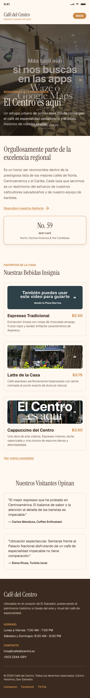
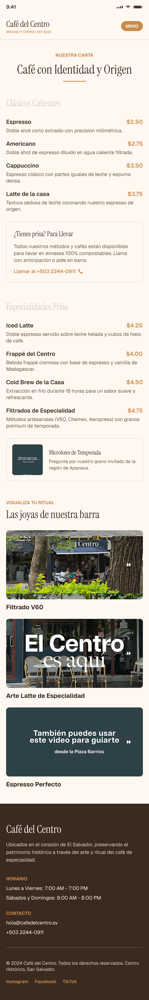
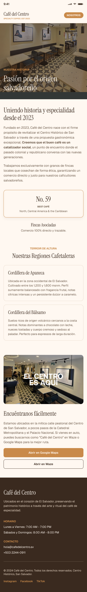
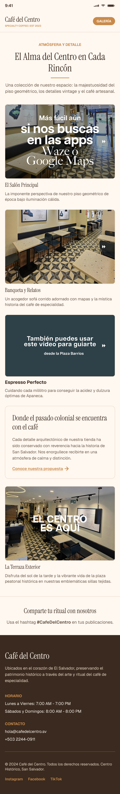
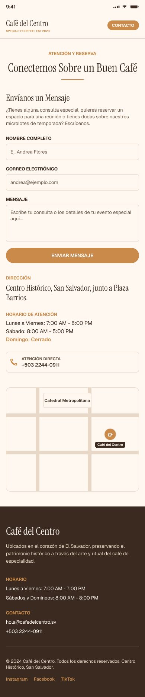

# Café del Centro · App móvil

App para pedir café en **Café del Centro**, una cafetería de especialidad en el Centro Histórico de San Salvador. Desde el teléfono podés ver el menú, elegir el tamaño de tu bebida, pagar y acumular puntos.

Es la versión móvil del proyecto de **Diseño y Programación de Software Multiplataforma (DPS941)**, Universidad Don Bosco, ciclo 02-2026. Comparte autenticación, base de datos y reglas de negocio con la versión web, donde está el panel de administración: un pedido hecho desde el teléfono aparece al instante en el panel del administrador, y cuando este lo marca como listo, el cliente lo ve actualizado en su teléfono.

## Enlaces

| | |
|---|---|
| Aplicación web desplegada | https://codehub-cafe-del-centro-web.vercel.app |
| Repositorio de la versión web | https://github.com/CristianHF29/codehub-cafe-del-centro-web |
| Diseño en Figma (web y móvil) | https://www.figma.com/design/WcpCQgZSYKtXfmcroyKasO/vistas-mobil |

## Mockups de Figma

| Inicio | Menú | Nosotros | Galería | Contacto |
|---|---|---|---|---|
|  |  |  |  |  |

## Entrega Foro 1

- **Video de demostración:** [Ver video](https://udbedu-my.sharepoint.com/:v:/g/personal/hf252375_alumno_udb_edu_sv/IQCtN-2-UVxfSaUael5wPyzDAZqpA-RhDCI1ZZ76po8zh-s?nav=eyJyZWZlcnJhbEluZm8iOnsicmVmZXJyYWxBcHAiOiJPbmVEcml2ZUZvckJ1c2luZXNzIiwicmVmZXJyYWxBcHBQbGF0Zm9ybSI6IldlYiIsInJlZmVycmFsTW9kZSI6InZpZXciLCJyZWZlcnJhbFZpZXciOiJNeUZpbGVzTGlua0NvcHkifX0&e=91Y5vg)
- **Documento:** [Investigación sobre React Native y Figma aplicados al proyecto (PDF)](Etapa3-CodeHub-Movil.pdf)
- **Código fuente entregado:** [ver versión del Foro 1](https://github.com/CristianHF29/codehub-cafe-del-centro-mobile/tree/foro-1)

## Entrega Foro 2

- **Video de demostración:** [Ver video](https://udbedu-my.sharepoint.com/:v:/g/personal/hf252375_alumno_udb_edu_sv/IQC02c4GFIAUQIGde5hmSK3nAfFTIbZccIG0Pfx9Izk0yKU?nav=eyJyZWZlcnJhbEluZm8iOnsicmVmZXJyYWxBcHAiOiJPbmVEcml2ZUZvckJ1c2luZXNzIiwicmVmZXJyYWxBcHBQbGF0Zm9ybSI6IldlYiIsInJlZmVycmFsTW9kZSI6InZpZXciLCJyZWZlcnJhbFZpZXciOiJNeUZpbGVzTGlua0NvcHkifX0&e=gRt7aK)
- **Documento:** [Integración de Firebase en la aplicación móvil (PDF)](Etapa3-Foro2-Firebase.pdf)
- **Código fuente entregado:** [ver versión del Foro 2](https://github.com/CristianHF29/codehub-cafe-del-centro-mobile/tree/foro-2)

## Qué hace

- Registro e inicio de sesión con correo o con cuenta de Google.
- Menú por categorías, con fotos y tamaños de 16 a 32 oz.
- Carrito con cantidades y total.
- Pago en efectivo o con tarjeta. Es una simulación: valida el número con el algoritmo de Luhn, la fecha y el CVV, pero no cobra nada y solo guarda los últimos 4 dígitos.
- Puntos de fidelidad: 1 punto por cada dólar completo.
- Historial de pedidos y puntos que se actualizan en tiempo real.

La app es solo para clientes. Si una cuenta de administrador intenta entrar, la app le indica que use la versión web.

## Arquitectura multiplataforma

La app móvil y la web usan **el mismo proyecto de Firebase**, por lo que comparten:

- **Autenticación:** la misma cuenta, con correo o con Google, sirve en las dos plataformas.
- **Datos:** las mismas colecciones de Cloud Firestore (`usuarios`, `productos` y `pedidos`).
- **Lógica de negocio:** el mismo formato de pedido, el mismo cálculo de puntos y el mismo flujo de estados (pendiente, listo y entregado).
- **Seguridad:** las mismas reglas de Firestore, publicadas en el repositorio web en [`firestore.rules`](https://github.com/CristianHF29/codehub-cafe-del-centro-web/blob/master/firestore.rules).

Los pedidos, los puntos y el catálogo se escuchan en tiempo real con `onSnapshot`. El pedido y la suma de puntos se guardan en una transacción: se aplican los dos o ninguno.

## Tecnologías

React Native, Expo, Expo Router y TypeScript. La autenticación usa Firebase Authentication y los datos se guardan en Cloud Firestore.

## Cómo correrlo

1. Cloná el repo e instalá las dependencias:

```bash
git clone https://github.com/CristianHF29/codehub-cafe-del-centro-mobile.git
cd codehub-cafe-del-centro-mobile
npm install
```

2. La app usa el inicio de sesión de Google, que no funciona en Expo Go. Por eso necesita una development build, que se compila una sola vez con EAS:

```bash
npm install -g eas-cli
eas login
eas build -p android --profile development
```

Al terminar, instalá el APK en el emulador o en un teléfono Android.

3. Arrancá el servidor de desarrollo:

```bash
npx expo start
```

Presioná `a` para abrir la app en el emulador de Android.

## Cómo probarla

Creá una cuenta desde **Regístrate** o entrá con **Continuar con Google**. Con esa misma cuenta podés entrar también a la versión web y ver los mismos puntos y pedidos.

## Estructura

```
src/
  app/          pantallas y navegación
  components/   piezas reutilizables (botones, tarjetas, campos)
  context/      sesión y carrito
  hooks/        lógica compartida, como la carga de productos
  services/     conexión con Firebase y consultas a Firestore
  constants/    colores y fuentes
  utils/        validaciones y formatos
scripts/        carga inicial del catálogo en Firestore
docs/mockups/   mockups de Figma
```

## Equipo CodeHub

| Integrante | Carnet |
|---|---|
| Cristian Arturo Hernández Flores | HF252375 |

## Licencia

Este proyecto está bajo la licencia [Creative Commons Atribución-NoComercial 4.0 Internacional (CC BY-NC 4.0)](https://creativecommons.org/licenses/by-nc/4.0/deed.es). Ver el archivo [LICENSE](LICENSE).